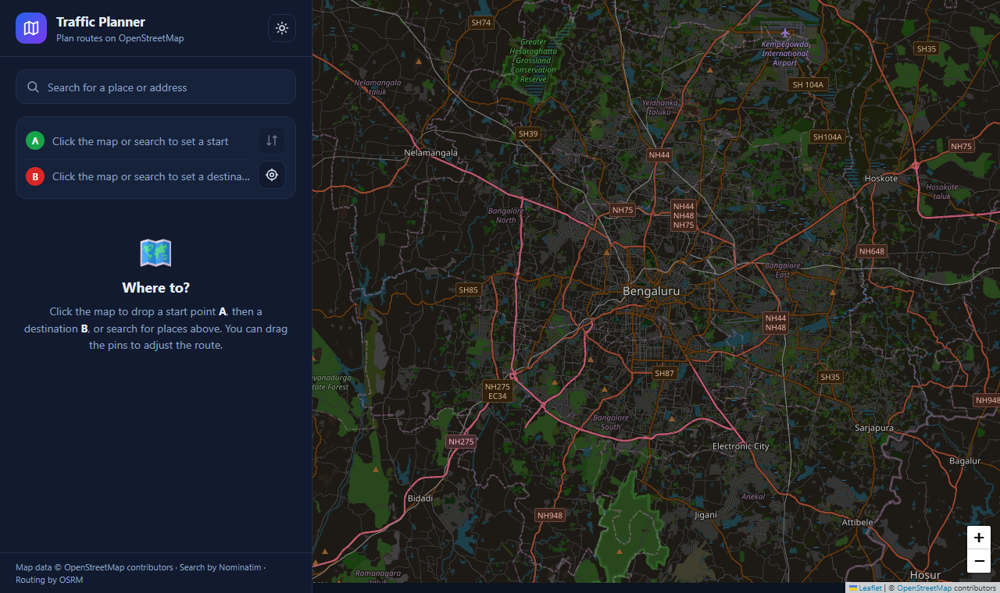

# Traffic Planner

[](https://github.com/DK6050/Traffic-Planner/actions/workflows/ci.yml)
[](LICENSE)


A route-planning web app built with **Angular 18**, **TypeScript** and **Leaflet**. Search for places, drop start and destination pins on the map, and get routes with alternatives, distance, travel time and turn-by-turn directions.

It runs entirely on free OpenStreetMap-based services, so **no API keys or accounts are needed**.



## Features

- Place search with live suggestions (Nominatim)
- Set start (**A**) and destination (**B**) by clicking the map, searching, or using your current location
- Draggable pins that update the route instantly
- Fastest route plus alternatives, with distance and travel time
- Turn-by-turn directions; click a step to zoom to that turn
- Swap start and destination, clear points individually or all at once
- Light and dark themes (follows your system, with a manual toggle that is remembered)
- Responsive layout for desktop and mobile
- Handles slow or failed requests, and ignores stale route responses
- Unit tests and a GitHub Actions CI pipeline

> **Note:** live traffic is not included. Travel times are free-flow estimates from OSRM.

## Tech stack

| Area | Technology |
|---|---|
| Frontend | Angular 18, TypeScript, RxJS |
| Map | Leaflet 1.9 with OpenStreetMap tiles |
| Geocoding | Nominatim |
| Routing | OSRM public demo server |
| Tests | Jasmine and Karma |
| CI | GitHub Actions |
| Optional backend | Node.js and Express (health check only) |

## Project structure

```
Traffic-Planner/
├── traffic-app/            Angular frontend (the app)
│   └── src/app/traffic-dashboard/   Map, search, routing UI
├── traffic-backend/        Optional minimal Express server
├── docs/                   Screenshots
├── .github/workflows/      CI pipeline
├── .env.example            Template for optional backend settings
├── CONTRIBUTING.md
├── LICENSE
└── README.md
```

## Getting started

### Requirements
- Node.js 18.19+ (20 recommended, see `.nvmrc`)
- npm 9+

### Run the app
```bash
git clone https://github.com/DK6050/Traffic-Planner.git
cd Traffic-Planner/traffic-app
npm install
npm start
```
Open http://localhost:4200.

### Optional: run the backend
The frontend does not need it. It is a small Express server with a `/health` endpoint, ready for your own additions.
```bash
cd traffic-backend
npm install
cp ../.env.example ../.env      # PowerShell: Copy-Item ..\.env.example ..\.env
npm start                        # http://localhost:3000/health
```

### Configuration
All settings are optional and live in a root `.env` file (git-ignored):

| Variable | Default | Purpose |
|---|---|---|
| `PORT` | `3000` | Backend port |
| `FRONTEND_ORIGIN` | `http://localhost:4200` | Origin allowed by the backend's CORS rule |

## Scripts (in `traffic-app`)

| Command | What it does |
|---|---|
| `npm start` | Dev server with live reload on port 4200 |
| `npm run build` | Production build into `dist/` |
| `npx ng test --watch=false --browsers=ChromeHeadless` | Run unit tests once (needs Chrome) |

## How to use

1. Click the map to drop **A**, then click again to drop **B**. A route appears.
2. Or type in the search box, then press **A** or **B** on a result to use it as start or destination.
3. Click a route card, or a grey route on the map, to switch between alternatives.
4. Click any direction step to zoom to it. Drag a pin to re-route.

## Troubleshooting

| Problem | Fix |
|---|---|
| `Port 4200 is already in use` | Stop the other `ng serve`, or run `npx ng serve --port 4300` |
| Map is blank or grey | Check your internet connection; tiles load from `tile.openstreetmap.org` |
| Search or routing says "failed" | The public Nominatim and OSRM servers rate-limit; wait a few seconds and retry |
| "My location" does nothing | Allow location permission in the browser (it requires `localhost` or HTTPS) |

## Usage limits

The public OpenStreetMap tile server, Nominatim (about 1 request per second) and the OSRM demo server are intended for light use. They are fine for development and demos. For production, self-host them or use a commercial provider, and keep the OpenStreetMap attribution visible.

## Roadmap ideas

- Live traffic layer from a provider with a free tier
- Other travel modes (walking, cycling)
- Shareable route links
- Save favourite places

## Contributing

Contributions are welcome. See [CONTRIBUTING.md](CONTRIBUTING.md).

## License

[MIT](LICENSE)

## Acknowledgements

Map data © [OpenStreetMap contributors](https://www.openstreetmap.org/copyright). Search by [Nominatim](https://nominatim.org/). Routing by [OSRM](https://project-osrm.org/). Maps by [Leaflet](https://leafletjs.com/).
